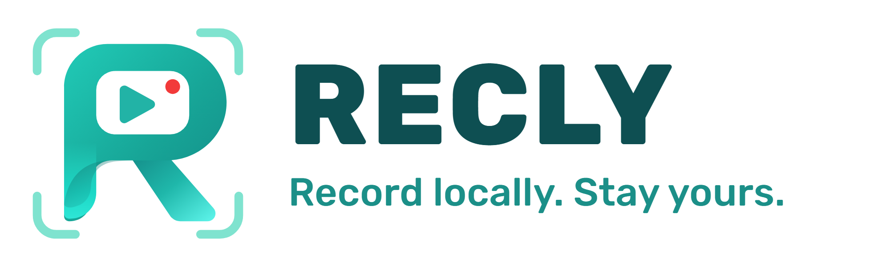
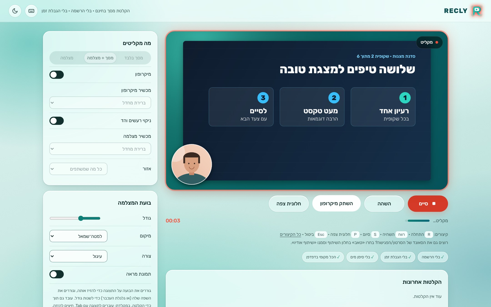
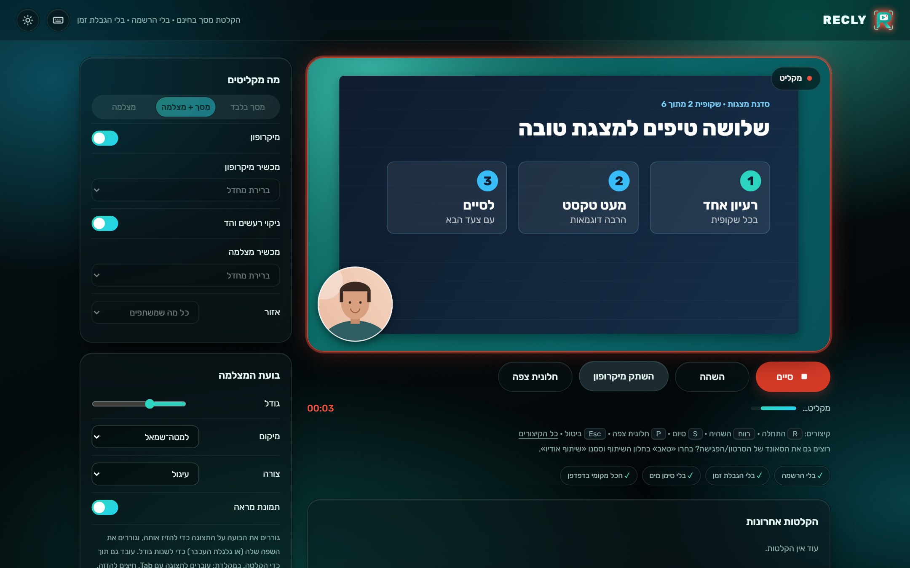
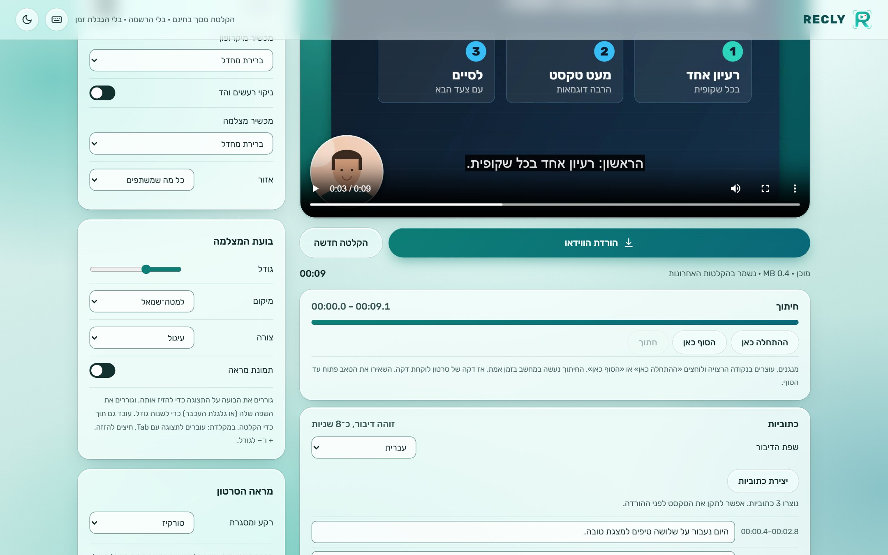
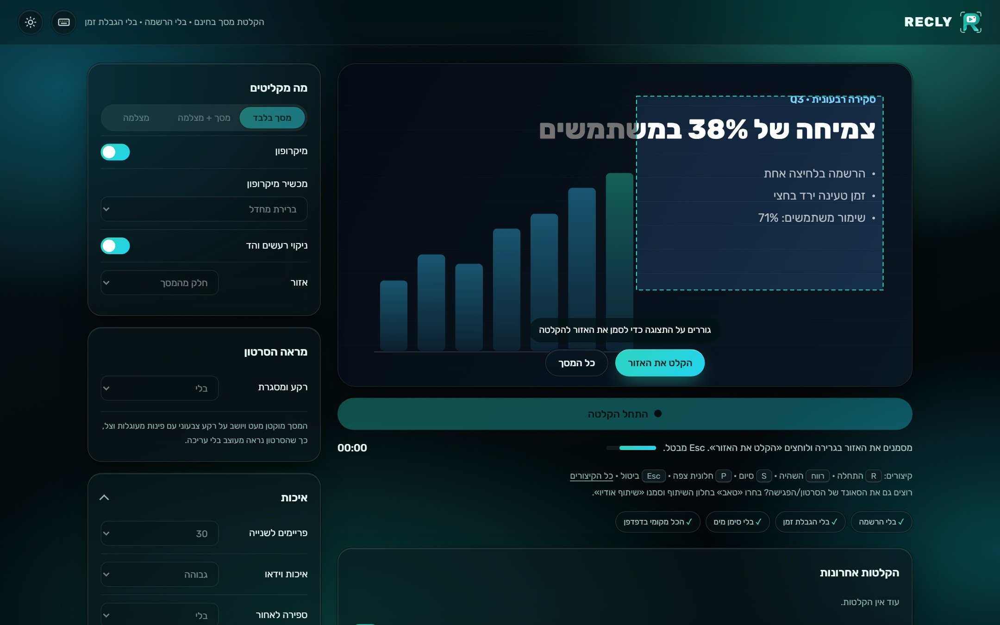

<div align="center">

<picture>
  <source media="(prefers-color-scheme: dark)" srcset="docs/brand/logo-dark.png">
  
</picture>

### Record locally. Stay yours.
<p dir="rtl"><b>מקליטים את המסך במחשב שלך. הסרטון נשאר רק שלך.</b></p>
<p dir="ltr">A free screen recorder that runs entirely in your browser. No sign-up, no upload, no time limit.</p>

<p>
  
  
  
  
  
  <a href="https://github.com/alonsa-93/recly/actions/workflows/ci.yml"></a>
</p>

<picture>
  <source media="(prefers-color-scheme: dark)" srcset="docs/screenshots/recording-dark.jpg">
  
</picture>

</div>

---

<div dir="rtl">

## 📖 בעברית

**Recly** הוא מקליט מסך חינמי שרץ כולו בדפדפן. אין חשבון, אין מנוי, אין סימן מים ואין הגבלת זמן. הסרטון נוצר במחשב שלך ונשאר בו: שום דבר לא עולה לשרת.

- 🖥️ **מקליטים מסך, חלון, טאב או רק חלק מהמסך**, עם אודיו מערכת ומיקרופון
- 🙂 **בועת מצלמה שנצרבת לסרטון**: עיגול, ריבוע מעוגל או רחב. גוררים, מגדילים בגלגלת, ומציגים במראה
- 🎙️ **דיכוי רעשים ומד עוצמה**, כדי לראות שהמיקרופון באמת קולט
- 🎨 **מסגרת ורקע מעוצבים** סביב המסך, בלי עריכה
- 🪟 **חלון שליטה צף עם טלפרומפטר**: טיימר, השהיה ועצירה מעל כל חלון, והטקסט שלך גולל לידך
- ✂️ **חיתוך התחלה וסוף**, והורדה כ-**MP4** (או WebM)
- 💬 **כתוביות אוטומטיות בעברית**, רק כשיש דיבור בהקלטה. המודל של ivrit.ai יורד פעם אחת, רק באישור שלך, והתמלול רץ במחשב. אפשר לערוך, להוריד SRT או לצרוב לסרטון
- 📚 **ספרייה של עשר ההקלטות האחרונות**, שמורה בדפדפן בלבד
- 📲 **מתקינים כאפליקציה** (PWA), ועובדים גם בלי אינטרנט
- ♿ **נגיש**: עברית מימין לשמאל, קיצורי מקלדת (גם במקלדת עברית), מצב בהיר וכהה, ובדיקת WCAG 2.1 AA אוטומטית

</div>

## 🌍 In English

**Recly** is a free screen recorder that runs entirely in your browser. No account, no subscription, no watermark, no time limit. The video is made on your computer and stays there: nothing is uploaded.

| | |
|---|---|
| 🖥️ **Screen, window, tab or a region** | with system audio and microphone |
| 🙂 **Camera bubble burned into the video** | circle, rounded or wide; drag, resize with the wheel, mirror |
| 🎙️ **Noise suppression and a level meter** | see that the mic is actually picking you up |
| 🎨 **Styled frame and background** | a polished look with no editing |
| 🪟 **Floating control window with a teleprompter** | timer, pause and stop above any window |
| ✂️ **Trim start and end** | download as **MP4** (or WebM) |
| 💬 **Automatic Hebrew captions** | offered only when the take has speech; the model downloads once, with your consent, and runs locally; edit, export SRT or burn in |
| 📚 **Library of your last 10 takes** | stored in the browser only |
| 📲 **Installable (PWA)** | works offline |
| ♿ **Accessible** | right-to-left Hebrew UI, keyboard shortcuts, light and dark themes, automated WCAG 2.1 AA checks |

## 📸 Screenshots
<sub>All screenshots use built-in demo media: a drawn slide deck and an illustrated presenter.</sub>

| Recording with a camera bubble (light) | Recording (dark) |
|---|---|
|  |  |
| **Trim and Hebrew captions** | **Record just part of the screen** |
|  |  |

---

## ⚡ Quick start
Recly is a static site: one `index.html` with no build step and no runtime dependencies. It needs to be served over `http(s)`, because browsers block the camera and microphone on `file://`.

**Windows, nothing to install:**
```powershell
git clone https://github.com/alonsa-93/recly.git
cd recly
.\install.bat
```
`install.bat` creates **Recly** shortcuts on the Desktop and in the Start menu. The shortcut runs `server.ps1`, a tiny static server built on Windows' own `HttpListener`, on `localhost:8777`, and opens Recly in a Chrome or Edge app window. Close the minimized PowerShell window to stop it.

**Any system:**
```bash
python -m http.server 8777
# then open http://localhost:8777
```
For the fastest captions on the CPU, serve with `Cross-Origin-Opener-Policy: same-origin` and `Cross-Origin-Embedder-Policy: credentialless` (`server.ps1` and `vercel.json` already do).

**Deploy:** any static host works. `vercel.json` sets the headers for Vercel.

## 🧩 How it works
- `getDisplayMedia()` captures the screen, `getUserMedia()` the camera and microphone, each on its own, so a failing camera never stops a screen recording.
- A worker-driven loop draws the screen and the camera bubble onto a `<canvas>`, so the bubble is part of the video and keeps running in a hidden tab.
- `AudioContext` mixes the microphone and system audio. `MediaRecorder` writes MP4 (H.264/AAC) where the browser supports it, otherwise WebM, with the duration header fixed before download.
- Captions: the audio is decoded to 16 kHz, a small detector checks for speech, and Whisper (`ivrit-ai/whisper-large-v3-turbo-onnx`) runs in a worker through transformers.js and ONNX Runtime, with WebGPU when available. The runtime is bundled in `vendor/`; only the model itself is downloaded, once, after you agree.

## 🛠️ Development
- `npm install` once, then `npm test`: 49 end-to-end tests run real recordings in Chromium with a fake camera, microphone and screen (Playwright), plus axe-core accessibility checks in both themes.
- `ONLY=<regex> npm test` runs the matching tests only.
- `node tests/full-flow.js tests/fixtures/speech-he.wav` is the full run with the **real** captions model (downloads it on the first run): record, detect speech, consent, download, transcribe, export, trim, and transcribe again offline.
- `node scripts/readme-art.js` rebuilds the logo images, icons, banner and screenshots in `docs/`.
- `package.json` is developer tooling only. The app has no dependencies and no build step.

## 🔐 Privacy
- The video, the audio and the captions never leave your computer. There is no server, no account and no analytics.
- The page makes no network requests, with one exception you approve: the captions model is downloaded from Hugging Face the first time you ask for captions, and then kept in the browser cache.
- Recordings in the library live in the browser's private storage (OPFS). "Save to folder" writes straight to a folder you choose.

## 🤝 Contributing and security
Issues and pull requests are welcome; see [CONTRIBUTING.md](CONTRIBUTING.md).
Found a security problem? Please report it privately, as described in [SECURITY.md](SECURITY.md).

## 📄 License
Recly is free software under the GNU General Public License v3.0. See [LICENSE](LICENSE).
Third-party components keep their own licenses; see [THIRD-PARTY-NOTICES.txt](THIRD-PARTY-NOTICES.txt).
